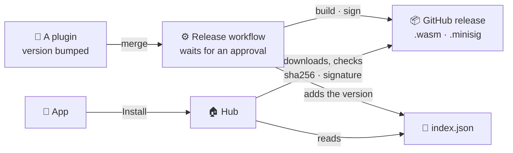

<div align="center">


# HomeMaid-plugins

**The plugins of [HomeMaid](https://github.com/ErwanHeschung/HomeMaid), and the registry the app installs them from.**<br>
Signed WebAssembly components, installed, updated and removed from your phone.

[](https://github.com/ErwanHeschung/HomeMaid-plugins/actions/workflows/check.yml)
[](https://github.com/ErwanHeschung/HomeMaid-plugins/actions/workflows/release.yml)


[](#license)

</div>

> [!NOTE]
> **Early days.** HomeMaid is a personal project at a very early stage, and so is this registry:
> one plugin for now, the one for my own devices. Yours are welcome: see
> [Write a plugin](#write-a-plugin).

## Plugins

| Plugin | Devices | May | Settings asked at install |
|---|---|---|---|
| [`tplink`](plugins/tplink) | TP-Link Tapo P300 power strip: one entity per outlet, local KLAP v2, its schedules kept by the strip itself | talk to devices on your home network | IP addresses, TP-Link account e-mail and password |

> [!TIP]
> **TP-Link Tapo**: turn on *Third-Party Compatibility* in the Tapo app first (*Me → Third-Party
> Services*), and reserve the strip's IP address on your router.

## Install a plugin

In the HomeMaid app: **Settings → Plugins**, then under *Available*, *Install*. The app shows what
the plugin may do and asks its settings; the hub downloads it, checks it and starts it at once,
without restarting. Updates appear in the same list (*Update to 0.2.0*), and keep your settings
and devices.

The hub reads [`index.json`](index.json) only then: it never needs the Internet to run.

## How it works



- **What you accept is what runs.** The hub installs the version and permissions you were shown,
  nothing else, and refuses a plugin asking for more than you granted.
- **Signed.** Every `.wasm` must match its sha256 and be signed with minisign by its author's key.
  The key is pinned at install: an update signed by another key is refused, even if this index
  changes it.
- **Sandboxed.** A plugin gets no files and no Internet, the local network at most, 64 MiB of
  memory and 60 s per call, and is restarted if it crashes.

## Official plugins

`plugins/<id>` is a Cargo workspace. Each plugin has a `registry.json`: its listing (name,
description, permissions, the settings the app asks).

```sh
rustup target add wasm32-wasip2
cargo test                                         # each plugin on a real hub, against a fake device
cargo build --release --target wasm32-wasip2       # the .wasm files
```

The plugins pin the SDK to a tag of HomeMaid (`plugin-api-v1.2.0`), and their tests run them on a
real hub at the same tag: a new hub or app release changes nothing here until the tag is bumped.

**To release one**, bump its version in its `Cargo.toml` and merge. The
[release workflow](.github/workflows/release.yml) waits for an approval (the `release`
environment), then builds, signs with the CI's key ([`minisign.pub`](minisign.pub)), creates the
release `<id>-v<version>` and adds the version to `index.json`.

## Write a plugin

```sh
cargo install cargo-generate
cargo generate --git https://github.com/ErwanHeschung/HomeMaid-plugins --subfolder template
```

You get a working plugin (one switch) to make yours: build it, try it on your hub, publish it. Its
release workflow builds, signs with your key and makes `entry.json` on each `v*` tag. See the
generated README, and HomeMaid's [`homemaid_plugin`](https://github.com/ErwanHeschung/HomeMaid/tree/main/core/plugin-api)
SDK.

## Publish a plugin

Open a PR adding your plugin, or a new version of it, to `index.json` (the `entry.json` of your
release):

```json
{
  "id": "my-plugin",
  "name": "My plugin",
  "description": "What it brings to the home, in one line.",
  "repo": "https://github.com/you/my-plugin",
  "key": "RWQ...",
  "settings": [
    { "key": "hosts", "label": "IP addresses (comma-separated)", "required": true },
    { "key": "password", "label": "Device password", "secret": true, "required": true }
  ],
  "versions": [
    {
      "version": "0.1.0",
      "api": "1.2",
      "permissions": ["local-network"],
      "url": "https://github.com/you/my-plugin/releases/download/v0.1.0/my_plugin.wasm",
      "sha256": "…",
      "signature": "untrusted comment: …\n…\ntrusted comment: …\n…\n"
    }
  ]
}
```

| Field | What |
|---|---|
| `id` | The id in your plugin's manifest |
| `key` | Your minisign public key (the second line of `minisign.pub`) |
| `settings` | Asked in the app at install. Secrets go to the hub's `secrets.toml` and are never shown again (read them with `secret()`); the others to `[plugin.settings]` (read them in `init`) |
| `api` | The plugin-api your SDK builds for (`API_VERSION`, `1.2.0` → `1.2`): older hubs do not offer it |
| `permissions` | Must match your manifest: the user accepts them at install |

CI downloads each `.wasm` and checks its `sha256` and its signature with `key`
([`check.py`](check.py)).

> [!IMPORTANT]
> **Keep your key.** Hubs pin it at install and refuse updates signed by another one. A PR
> changing a key fails CI unless labelled `key-change`, and needs a good reason (a lost key):
> every hub that installed the plugin must then remove and reinstall it.

<details>
<summary><b>Repository layout</b></summary>

| Path | What |
|---|---|
| `plugins/` | The official plugins, a Cargo workspace |
| `index.json` | The registry the hubs read |
| `check.py` | Checks `index.json`: fields, ids, checksums, signatures, key changes |
| `tools/release.py` | Builds, signs and releases the plugins not in the index yet |
| `minisign.pub` | The public key of the official plugins (signed by CI) |
| `template/` | The `cargo generate` starter plugin |

</details>

## License

Licensed under either of [Apache License 2.0](LICENSE-APACHE) or [MIT license](LICENSE-MIT), at
your option. Contributions are welcome under the same terms.
